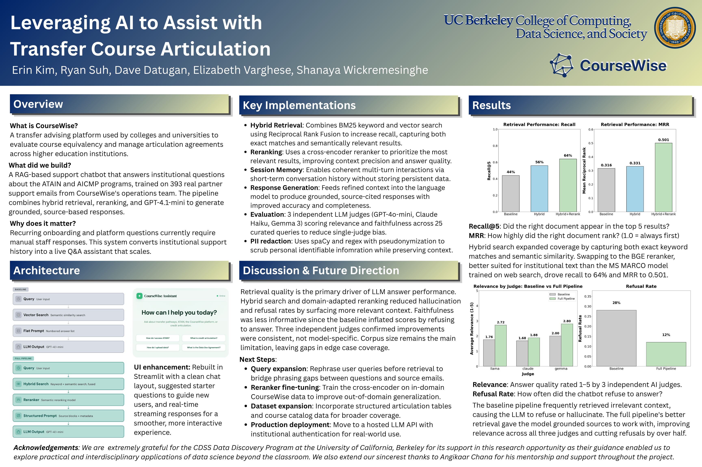

# CourseWise AI Chatbot

**Erin Kim, Ryan Suh, Dave Datugan, Elizabeth Varghese, Shanaya Wickremesinghe**  
UC Berkeley Data Discovery Program · Spring 2026 · In collaboration with [Equivalence Systems](coursewise.com)

---



---

## Overview

CourseWise is a transfer advising platform used by colleges and universities to evaluate course equivalency and manage articulation agreements across higher education institutions. This project builds a RAG-based support chatbot trained on 393 real partner support emails, combining hybrid retrieval, reranking, and GPT-4.1-mini to generate grounded, source-based responses to institutional queries about the ATAIN and AICMP programs.

**Project mentor:** Angikaar Chana, COO of Equivalence Systems  

---

## Pipeline

```
User Query
    │
    ▼
Hybrid Search (BM25 + ChromaDB vector search, fused via RRF)
    │
    ▼
BGE Reranker (BAAI/bge-reranker-base cross-encoder)
    │
    ▼
Structured Prompt (source blocks with metadata → GPT-4.1-mini)
    │
    ▼
Response
```

**Baseline** uses vector-only search and a flat prompt.  
**Full pipeline** adds BM25 hybrid search, BGE reranking, a structured source-block prompt, and GPT-4.1-mini.

---

## Results

| Metric | Baseline | Hybrid | Hybrid + Rerank |
|--------|----------|--------|-----------------|
| Recall@5 | 44% | 56% | **64%** |
| MRR | 0.316 | 0.331 | **0.501** |
| Refusal Rate | 28% | — | **12%** |

Answer quality validated by 3 independent LLM judges (GPT-4o-mini, Claude Haiku, Gemma 3) across 25 curated test queries.

---

## Tech Stack

- **Embeddings:** `sentence-transformers/all-MiniLM-L6-v2`
- **Vector store:** ChromaDB
- **Keyword search:** BM25 via `rank-bm25`
- **Reranker:** `BAAI/bge-reranker-base`
- **LLM:** GPT-4.1-mini (OpenAI)
- **Judges:** GPT-4o-mini, Claude Haiku 4.5, Gemma 3
- **UI:** Streamlit
- **PII redaction:** spaCy NER + regex

---

## File Structure

| File | Description |
|------|-------------|
| `coursewise_chatbot.py` | Core chatbot: vector store, embedding model, LLM refiner |
| `hybrid_search.py` | BM25 + RRF fusion |
| `reranker.py` | BGE cross-encoder reranker |
| `preprocessing.py` | PII redaction pipeline (spaCy + regex) |
| `query_expansion.py` | GPT-4o-mini query rewriting for retrieval |
| `generation_eval.py` | Multi-judge generation evaluation |
| `retrieval_eval.py` | Recall@5 and MRR retrieval evaluation |
| `streamlit_chatbot_app.py` | Streamlit chat UI |
| `memory.py` | Short-term conversation memory |

---

## Setup

### 1. Install dependencies

```bash
pip install -r requirements.txt
```

### 2. Set up environment variables

Create a `.env` file in the root directory:

```
OPENAI_API_KEY=your_openai_key
ANTHROPIC_API_KEY=your_anthropic_key
GOOGLE_API_KEY=your_google_key
```

### 3. Add your dataset

The dataset is proprietary and not included. The pipeline expects a `qa_pairs_dataset_redacted.json` file in the root directory with the following structure:

```json
{
  "qa_pairs": [
    {
      "qa_id": "qa_0000",
      "subject": "...",
      "question_text": "...",
      "answer_text": "...",
      "thread_id": "thread_000",
      "tags": {
        "product_area": "ATAIN",
        "priority": "medium",
        "request_type": "general_inquiry",
        "response_quality": "detailed"
      }
    }
  ]
}
```

Only pairs tagged `detailed` or `moderate` response quality are indexed.

### 4. Run the chatbot

```bash
streamlit run streamlit_chatbot_app.py
```

### 5. Run evaluations

```bash
# Retrieval eval (fast, no LLM calls)
python3 retrieval_eval.py

# Generation eval (multi-judge, ~15 min)
python3 generation_eval.py
```

---

## What's Not Included

- `qa_pairs_dataset.json` and `qa_pairs_dataset_redacted.json` — proprietary partner data
- `chroma_db/` — auto-generated on first run
- `.env` — API keys

---

## Acknowledgements

We thank the CDSS Data Discovery Program at UC Berkeley for this research opportunity. We also thank Angikaar Chana for his mentorship and guidance throughout the project.
